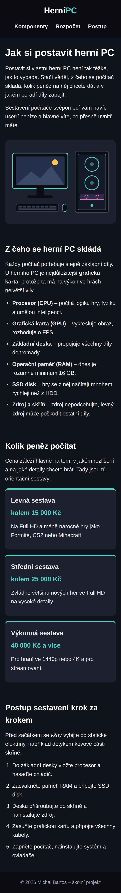
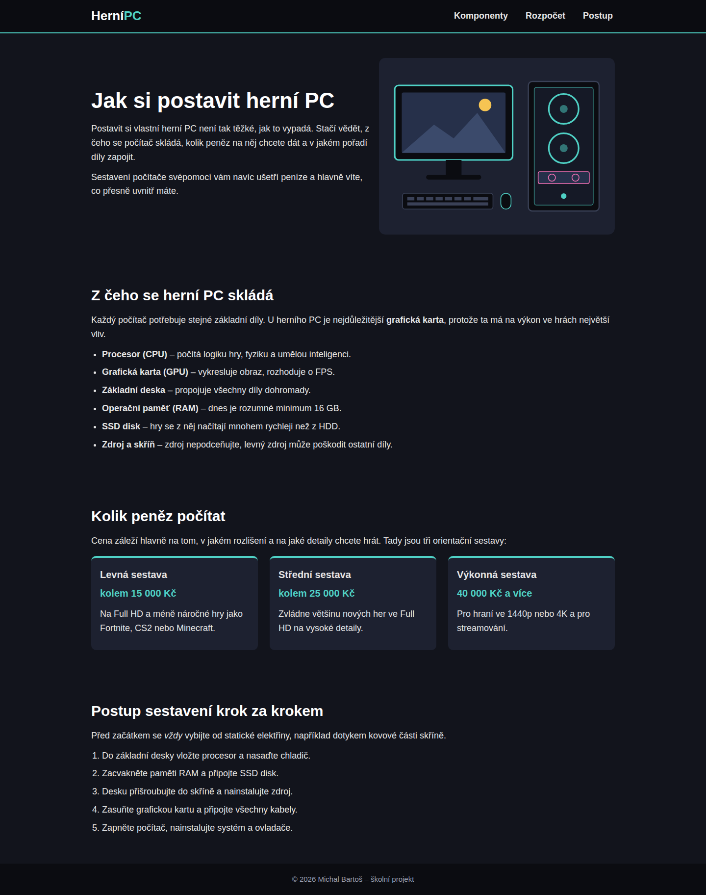

# Jak si postavit herní PC

Jednostránkový web pro začátečníky o tom, jak si postavit herní PC. Školní projekt na kapitoly 7–9 (mobile-first, SEO).

Web: https://bartosmichal15.github.io/herni-pc-pro-zacatecniky/

## Klíčová slova

- herní PC
- sestavení počítače
- grafická karta
- procesor
- komponenty

Klíčová slova jsou v title, meta description, v h1/h2 a v úvodním odstavci, ale snažil jsem se je neopakovat zbytečně.

## Co jsem použil

- mobile-first CSS – základ je pro mobil, pro obrazovky od 768 px je jedna media query s `min-width`
- na desktopu se menu dá vedle loga, obrázek je vedle textu a karty se sestavami jsou ve 3 sloupcích (Flexbox + Grid)
- sémantické značky `header`, `nav`, `main`, `section`, `article`, `footer`
- jeden `h1`, pod ním tři `h2`
- obrázek je SVG (má jen 2 kB) s `max-width: 100%` a `height: auto`, má alt text
- seznamy `ul` a `ol`, `strong` a `em` jen tam, kde to dává smysl

## Screenshoty

Mobil (375 px):

Desktop (1440 px):

